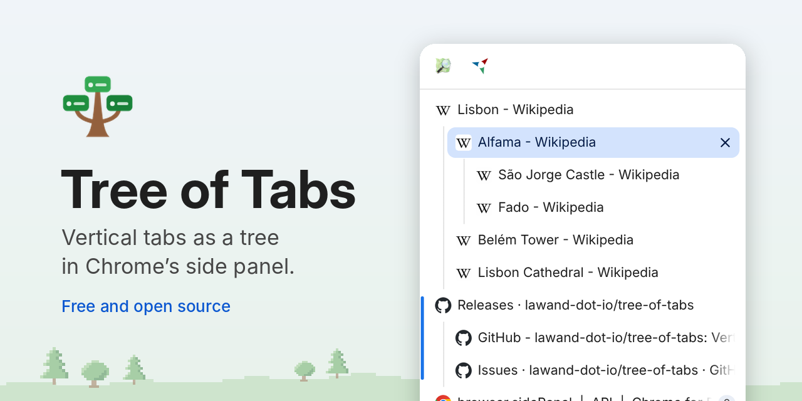
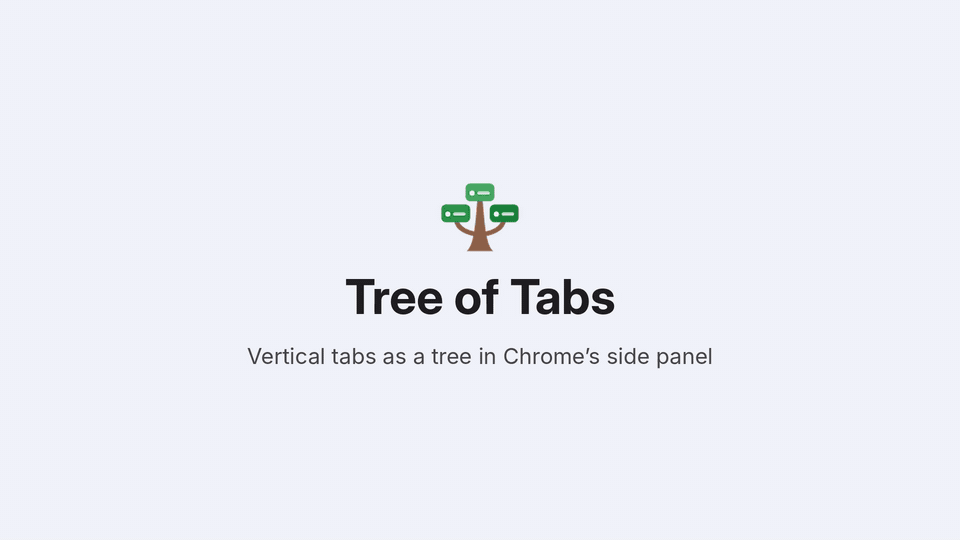

# Tree of Tabs

<picture>
  <source media="(prefers-color-scheme: dark)" srcset="docs/social-preview-dark.png">
  
</picture>

Vertical tabs for Chrome, shown as a tree in the side panel. Tabs you open from
a page nest under it, so you can always tell where a tab came from and which
tabs belong together. Drag tabs to reorganize them, and collapse the trees
you're not using.
It works like Firefox's [Tree Style Tab](https://github.com/piroor/treestyletab),
and looks like part of Chrome.

Built with [Claude Code](https://claude.com/claude-code).



<sub>The demo shows articles from [Wikipedia](https://en.wikipedia.org/wiki/Lisbon), available under [CC BY-SA 4.0](https://creativecommons.org/licenses/by-sa/4.0/).</sub>

## Install

**[Add Tree of Tabs to Chrome](https://chromewebstore.google.com/detail/tree-of-tabs/goknfcebnofoghkgcmpjhlokkgefbokm)** from the Chrome Web Store.

Then click the Tree of Tabs button in the toolbar (pin it from the puzzle menu
first), or press Alt+Shift+T (Option+Shift+T on a Mac), to open the tree. Needs
Chrome 116 or newer.

To install it by hand instead, download the ZIP from the
[latest release](https://github.com/lawand-dot-io/tree-of-tabs/releases/latest)
and unzip it. Then open `chrome://extensions`, turn on **Developer mode**, click
**Load unpacked** and pick the unzipped folder.

Found a bug? [Report it](https://github.com/lawand-dot-io/tree-of-tabs/issues).
Have an idea? [Suggest a feature](https://github.com/lawand-dot-io/tree-of-tabs/discussions/categories/feature-requests).

## Features

- **Tabs a page opens become its children.** That covers links opened in a
  new tab, middle clicks and pages that open new tabs. Tabs you open from the
  browser itself (the address bar, bookmarks, an extension's options page)
  start their own tree. So do blank new tabs (Ctrl+T), unless a setting makes
  them children.
- **Drag and drop** in the panel:
  - drop on the middle of a tab to make it a child,
  - drop on the top or bottom edge to place it before or after as a sibling
    (dropping between a parent and its first child makes it the first child),
  - drop on the empty space below the tabs to make it a top-level tree,
  - drop onto the pinned bar (shown once at least one tab is pinned) to pin,
    or drag a pinned tab into the tree to unpin it. To pin the first tab, use
    **Pin** in the right-click menu.

  The whole subtree moves with the tab you drag. With several tabs selected
  (Ctrl/Cmd+click or Shift+click), they all move together. You can also drag
  between windows, and drop links from web pages to open them at that spot.
- **The native tab strip stays in sync.** Tree order and Chrome's tab order
  always match. Moving a tab in the tab strip moves its subtree too, and its
  new parent comes from where you dropped it.
- **Collapse and expand** a subtree by pointing at its parent: the parent's
  icon turns into an arrow you can click (or use Left and Right on the keyboard).
  There is no arrow otherwise, so the tree stays calm. A collapsed tree shows
  how many tabs it hides, and it expands again when one of its hidden tabs gets
  focus (for example through Ctrl+Tab).
- **Never collapse**: if you don't use collapsing, turn it off in Settings.
  The arrows and the collapse menu items go away and every tree stays
  expanded.
- **Closing a parent** promotes its first child, like Tree Style Tab does.
  Settings can instead move all its children up a level, or close them along
  with it. Closing a collapsed parent closes its hidden tabs too (also
  configurable).
- **Keep the window open** (advanced, off by default): closing a window's
  last tab from the tree opens a new tab first instead of closing the window.
  Closing it from Chrome's own tab strip or with the keyboard shortcut still
  closes the window; extensions can't change that.
- **Context menu**: new child tab, reload, duplicate, pin, mute, collapse or
  expand all, indent and outdent, move a tree to a new window, close children,
  close tree, close other tabs, close tabs below. Like Chrome's own menu, the
  last two leave pinned tabs open.
- **New tab button**: click it for a new tree. Middle-click it, or right-click
  it and pick from the menu, for a new tab under the current tab.
- **Keyboard**: arrow keys move through the tree, Left and Right collapse and
  expand, Enter activates (on a split view, it switches to the other half),
  Delete closes, Shift+F10 opens the menu.
  Alt+Shift+T toggles the panel; you can change it at `chrome://extensions/shortcuts`.
- **Persistence**: the tree survives service worker restarts, extension
  updates and browser restarts. After a browser restart it is matched back to
  the restored tabs by URL.
- **Full screen**: Chrome keeps the side panel open next to full screen videos
  and pages, so Tree of Tabs can close it when you go full screen. The first time,
  the panel shows a short explanation instead of the tree and lets you choose
  whether to hide it; you can change this later in Settings. Chrome doesn't let
  extensions reopen the side panel by themselves
  ([Chromium issue 578117954](https://issues.chromium.org/issues/578117954)),
  so after full screen you bring it back with the toolbar button or Alt+Shift+T.
- **Guide lines**: thin lines run down from each parent, so you can see which tabs
  belong to it, even several levels deep. You can hide them in Settings.
- **Split views** (two tabs side by side) show as one row with both halves,
  each with its own icon, title and close button. The half in focus is
  highlighted. The pair is one item in the tree: it moves, nests and collapses
  together, and tabs opened from either half become its children. Closing one
  half leaves the other in its place. Tree of Tabs never moves the halves
  themselves, since that would end the split view in Chrome; it moves the tabs
  around them instead.
- **Tab groups** show as a colored line along the group's tabs, and pinned
  tabs as a row of icons at the top. A spinner shows while a page loads.

## Looking native

The panel uses Chrome's own Material 3 colors, its system font at 13px, its
icons, its 8px rounded tab shapes, and its favicon cache (so `chrome://` pages
and discarded tabs get the right icon too). It follows light and dark mode.
Chrome doesn't let extensions read the active browser theme, so a custom theme
won't change the panel. The colors are all variables in `src/theme.css` if you
want to tweak them.

For the classic vertical tabs layout, put the side panel on the left: open
`chrome://settings/appearance` and set **Side panel position** to
**Show on left**.

## Privacy

Tree of Tabs never sends your tabs or browsing anywhere. It has no analytics,
no accounts and no servers. See the [privacy policy](PRIVACY.md).

## Development

There is no build step. The extension is plain ES modules: to try a change, load
this folder itself with **Load unpacked**, and reload it on `chrome://extensions`
after editing.

```
src/
  background.js      service worker: owns the tree and keeps the tab strip in sync
  tree.js            pure tree logic (planning moves, inferring parents, ...)
  settings.js        defaults and storage
  theme.css          Chrome-matching colors and type, shared by all pages
  sidepanel/         the tree UI
  options/           the settings page
test/
  tree.test.js       unit tests for tree.js
  e2e/run.js         loads the extension into Chromium and drives real tabs
CHROMEWEBSTORE.md    everything for the Chrome Web Store listing and how to package
PRIVACY.md           the privacy policy the store listing links to
docs/                screenshots, the README banner and social preview, release notes
tools/make-icons.mjs regenerates icons/ (needs Playwright)
tools/make-social-preview.py  rebuilds the banner from docs/screenshot-*.png
tools/demo/          records the demo video and GIF in docs/demo/ (see capture.mjs)
tools/chrome-devtools-mcp.sh  starts the Chrome DevTools MCP server (see below)
```

```sh
npm test                    # unit tests
npm run test:e2e            # end-to-end, needs Playwright and Chromium
node test/e2e/run.js shots/ # also saves light and dark screenshots
```

GitHub runs both test suites on every push and pull request
(`.github/workflows/test.yml`). The Release workflow
(`.github/workflows/release.yml`) builds the store ZIP and publishes it as a
GitHub release: run it from the Actions tab, or push a version tag such as
`v1.0.1`.

### Chrome DevTools MCP server

`.mcp.json` registers the [Chrome DevTools MCP server](https://github.com/ChromeDevTools/chrome-devtools-mcp)
with its extension tools, as Chrome's "Build with AI" docs suggest, so Claude
Code can install, reload and inspect the extension in a real browser.
`tools/chrome-devtools-mcp.sh` picks how to run it:

- On your computer it connects to your running Chrome (`--autoConnect`).
  Turn on remote debugging at `chrome://inspect/#remote-debugging` first
  (Chrome 144+).
- In a Claude Code cloud session it starts the preinstalled Chromium headless.

Claude Code asks you to approve project MCP servers the first time it starts
in this folder. The server sends Google usage statistics unless you add
`--no-usage-statistics` to the script.

### Claude Code skill

`.claude/skills/chrome-extensions/` is the `chrome-extensions` skill from
Google's [Modern Web Guidance](https://github.com/GoogleChrome/modern-web-guidance):
Chrome's rules for Manifest V3 extensions and for publishing to the Chrome Web
Store, which Claude Code reads when working in this folder. It's plain text,
copied unchanged (version in `skill-version.txt`). To update it, run
`npx modern-web-guidance@latest install --choose` and pick `chrome-extensions`.

### How it works

The background worker stores only a parent id per tab, plus which tabs are
collapsed. Sibling order is always the native tab order: the worker keeps each
subtree contiguous in the tab strip, right after its parent. Every tab event
and panel command runs through a single queue, so each one sees the result of
the one before it. Moves the worker makes itself are recorded, so their
`onMoved` events aren't mistaken for the user dragging in the tab strip.

## Limitations

- Chrome's side panel belongs to one window, and extensions can only open it
  when you click or press a shortcut. So a new window starts without the tree;
  open it with the toolbar button or Alt+Shift+T
  ([Chromium issue 578112289](https://issues.chromium.org/issues/578112289)).
  The first time you open the tree with several windows open, the panel
  explains this with a short tip.
- Chrome doesn't tell extensions when a page opens a tab if that page is an
  extension's page (like a settings page). For those, Tree of Tabs goes by the
  tab Chrome names as the opener, so a tab opened some other way while an
  extension page is active (a bookmark, say) also nests under that page.
- Chrome's horizontal tab strip can't be hidden by an extension.
- Collapsing a tree only hides tabs in the panel. Chrome has no API for
  hiding tabs in the tab strip.
- Chrome may add or remove a tab from a tab group when the tree moves it
  in or out of the group's range.
- A few moves can't keep a split view together: moving it to another window,
  or putting one split view before another. Chrome 155 lets extensions pair
  the tabs again afterwards, which Tree of Tabs does; before that they stay
  separate.

## License

Tree of Tabs is released under the [MIT License](LICENSE): you can use, change and
share it freely, as long as the copyright notice stays with the code.

Two parts come from Google and keep their own license, the
[Apache License 2.0](https://www.apache.org/licenses/LICENSE-2.0):

- the icons in `src/sidepanel/icons.js`, from
  [Material Design Icons](https://github.com/google/material-design-icons)
  (license: `src/sidepanel/icons.LICENSE`);
- the Claude Code skill in `.claude/skills/chrome-extensions/`, from
  [Modern Web Guidance](https://github.com/GoogleChrome/modern-web-guidance)
  (license: `.claude/skills/chrome-extensions/LICENSE`).
